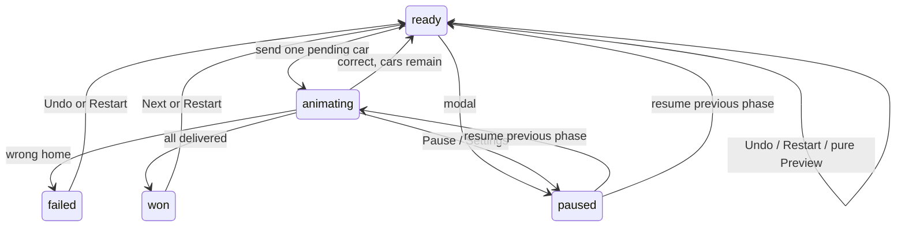

# Architecture

`core/` has no DOM, Phaser or SDK imports. `model.ts` defines the finite state machine and immutable snapshots. `simulateMove` produces a complete synchronous result and node trace before animation starts. It reads the old sign, chooses an edge, then writes the roof imprint. Reaching the wrong home retains sign changes and produces `failed`. Undo restores the full pre-trip snapshot. A maxSteps guard remains behind the DAG validator.

`solver.ts` memoizes by sorted pending IDs and switch memory; failed routes are pruned. At most six unique IDs give 720 complete permutations. Counts are exact within this limit. It returns a complete example and every viable first move. It can find an unsolvable ready position; Hint reports that honestly. It never treats an incorrect delivery as recoverable without Undo.

`generator.ts` builds ordered binary DAG trees with optional downstream entries, seeded Mulberry32 randomness and FNV-1a seed hashing. Destinations are derived by simulation of an intended order. Validation, solver checks, a bound on permissive orders, distinct car roles and active changes at every switch filter candidates. Runtime Daily has 32 attempts and a known validated campaign fallback.

`levels/campaign.json` is the frozen reviewed content. Three introductions are explicitly authored, including the required RED/BLUE/GREEN example. The other candidates are deterministic, filtered and inspected as maps. Graph variants preserve noncrossing tree routes; additional docks join a visible downstream switch. `release/metadata/level-audit.json` records counts and solutions' metrics.

`main.ts` serializes UI actions. On dispatch it stores `animating`, disables other game actions, and passes an immutable trace to `BoardScene`. Only the completion callback commits the already-computed result. No physics or tween position determines a delivery. The scene advances one progress clock from frame delta with a delta cap; pause freezes that clock. Resize rebuilds vector objects, keeps trace cursor/time, and reconstructs the moving car at the same progress. Async SVG textures have explicit intrinsic dimensions and a pending-load guard.

The board is Phaser 3 Canvas. Accessible native DOM controls provide keyboard, dialog focus trapping, touch and readable fleet cards. ResizeObserver sizes the renderer to the actual map element using Scale.NONE and a resized camera; this avoids Scale.RESIZE guessing stale parent dimensions after the fleet wraps. SVG cars/houses and drawn scenery share the original art language. No external fonts.

`AudioBus` synthesizes short sine-tone effects into a master GainNode. User preference, SDK mute and pause gate the master immediately, including already scheduled notes. AudioContext is created/resumed only following a gesture. `MusicLoop` synthesizes an original 64-step, eight-bar theme at 84 BPM through a separate music gain bus. An audio-clock lookahead scheduler avoids gaps and stale-note bursts. It owns one interval, releases oscillator/gain nodes on completion, keeps musical position across pauses, and is never recreated on level changes. A separate saved music boolean defaults safely for older schema-v2 saves. No downloaded audio is used.

## State transitions

Failed/won phases may also be paused and restored. Undo and level changes are blocked during animation and all modals. Visibility loss freezes rendering/audio without sending extra SDK gameplay events or altering the logical state. Return resumes unless a modal remains. UI Pause/Settings/level select explicitly stop gameplay; actual playable return starts it. The adapter deduplicates events and remembers the desired state if init is still pending.

## Platform/storage boundaries

Standalone includes no CrazyGames module or network call. Basic dynamically loads the official SDK, degrades gracefully on errors/timeouts and uses safe localStorage. The SDK can initialize after the first local playable frame. Full waits for bounded SDK init before loading saves and uses SDK Data as its sole source. If Data is absent, cloud mode uses an ephemeral session (no hidden localStorage copy).

Schema v2 validates stars, IDs, current street and booleans; v1 migrates, unknown versions reset safely. Storage exceptions are swallowed at the port boundary, so session play survives disabled/quota-limited storage. Save retrieval is synchronous after platform initialization. Full does not silently import Basic local data: a migration must be designed and reviewed before upgrading an already published Basic game.

Full's `betweenLevels` hook runs only after a won state when pressing Next. Ad callbacks mute on start, release on finished/error; exceptions and a 15s pre-start watchdog also release the input lock. Once adStarted arrives, that watchdog is cancelled: a real ongoing ad remains paused/muted until adFinished or adError. Nothing invokes ads in Basic/standalone. Full has no rewarded ads. Full integration remains a future configuration needing live portal review.

No backend, identifiers, analytics or personal session statistics. Dev debug data exists only in development builds. Scene texture keys are bounded by the small asset palette; regenerated Phaser objects are explicitly destroyed on redraw. The app owns one key listener, one visibility listener, one ResizeObserver and one Phaser scene rather than accumulating them on Restart.
